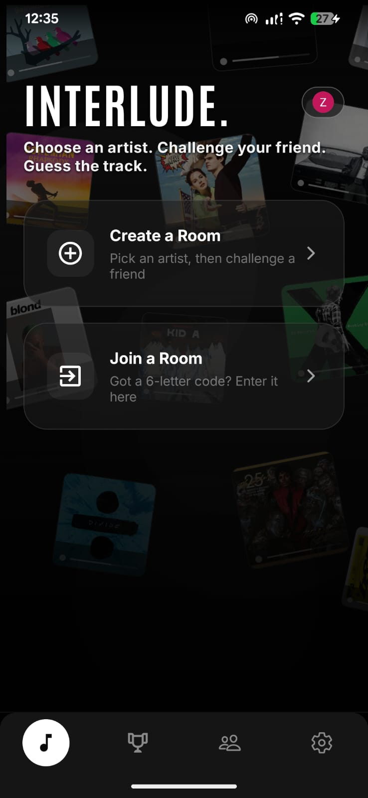
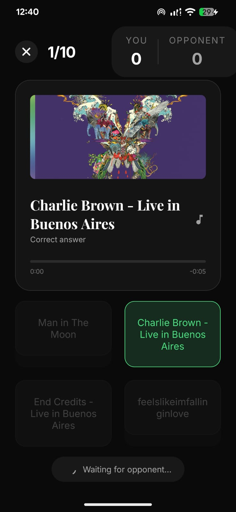
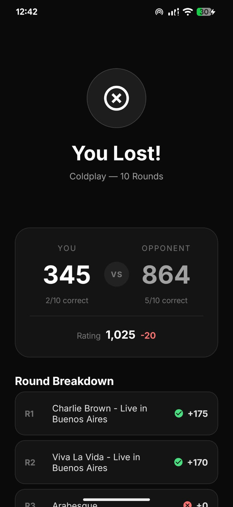
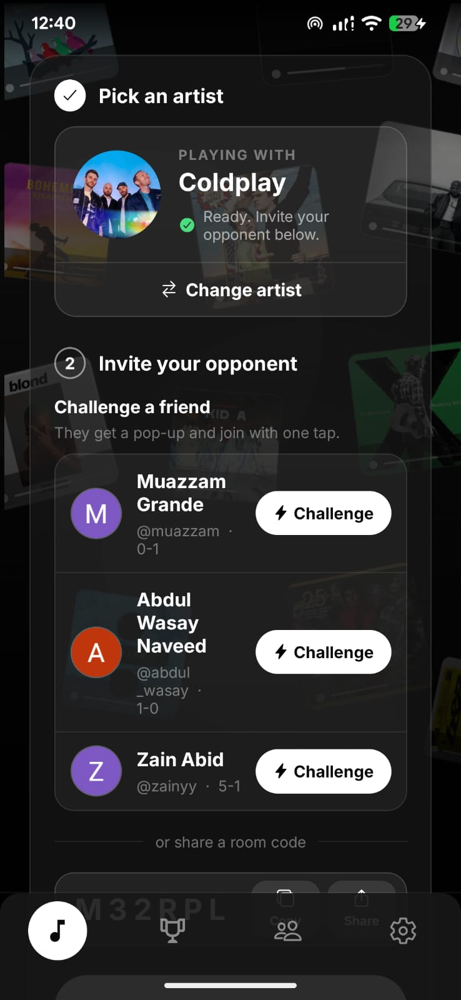
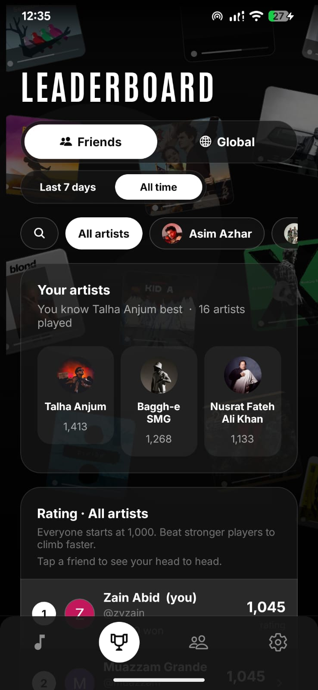
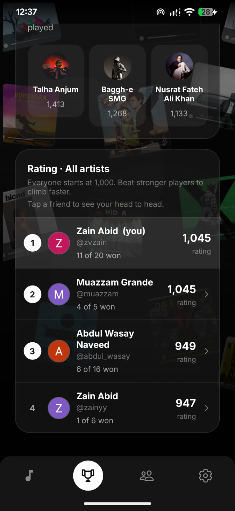
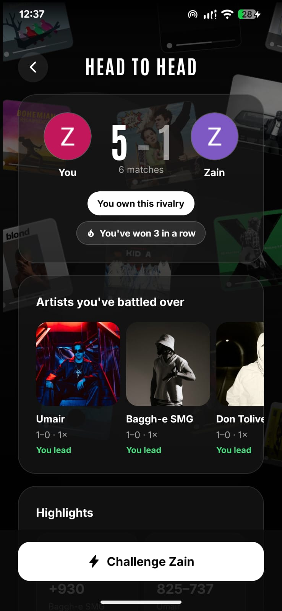

# Interlude

**Choose an artist. Challenge your friend. Guess the track.**

Interlude is a real-time, two-player music guessing game for Android and iOS. Pick any artist, challenge a friend, and race each other through 10 rounds of 3-second clips. The faster you name the song, the more you score.

<p align="center">
  
  &nbsp;
  
  &nbsp;
  
</p>

---

## Features

- **Any artist.** Search Spotify's catalog and build a 10-song match from that artist's tracks.
- **Real-time head-to-head.** Both phones hear the same clip at the same moment, synced to the host's clock.
- **Challenge friends with one tap.** No codes needed: your friend gets a pop-up and joins instantly. Room codes are still there for anyone else.
- **Friends and usernames.** Search players by username or name, send requests, and track your record against each friend.
- **Head to head.** See who owns the rivalry, win streaks, and which artists you've battled over.
- **Leaderboards.** Per-artist boards rank your best match. The All artists board uses an **Elo rating**, so beating stronger players counts for more.
- **Notifications.** Challenges and friend requests reach you even when the app is closed, with Join and Decline right on the notification. Inside the app, messages use the same dark, themed cards, and you choose which alerts you get in Settings.
- **Built for flaky networks.** Detects when the other player drops, pauses the match, and resyncs on reconnect.
- **Server-side checks.** Answers are graded on the server, so a modified app can't claim a wrong answer was right.
- **Fair endings.** Leaving a match counts as a loss, a player who disappears for a minute forfeits, a match can't be closed before its last round, and a closed app can rejoin its match.

---

## Screenshots

<table>
  <tr>
    <td align="center"></td>
    <td align="center"></td>
    <td align="center"></td>
  </tr>
  <tr>
    <td align="center"><b>Home</b><br/>Create a room or join with a code</td>
    <td align="center"><b>Create a room</b><br/>Pick an artist, then challenge a friend</td>
    <td align="center"><b>A round</b><br/>3-second clip, 4 options, 8 seconds</td>
  </tr>
  <tr>
    <td align="center"></td>
    <td align="center"></td>
    <td align="center"></td>
  </tr>
  <tr>
    <td align="center"><b>Results</b><br/>Score, rating change, round breakdown</td>
    <td align="center"><b>Leaderboard</b><br/>Friends or Global, by artist</td>
    <td align="center"><b>Rating</b><br/>Elo ranking across all artists</td>
  </tr>
  <tr>
    <td align="center"></td>
    <td></td>
    <td></td>
  </tr>
  <tr>
    <td align="center"><b>Head to head</b><br/>Your record against a friend</td>
    <td></td>
    <td></td>
  </tr>
</table>

---

## How a match works

1. **Host picks an artist.** Interlude builds a 10-song list from that artist's catalog and finds a preview clip for each song.
2. **Invite an opponent.** Challenge a friend directly, or share the 6-letter room code.
3. **Play 10 rounds.** Each round plays a 3-second clip. Pick the right song from 4 options before the 8-second timer runs out.
4. **See the results.** Final scores, a round-by-round breakdown, and how your rating changed.

### Scoring

| Answer | Points |
|---|---|
| Wrong or no answer | 0 |
| Right | 100 + a speed bonus of up to 100 |

The speed bonus is `100 − floor(ms × 100 / 8000)`: answer instantly for the full 100, and it reaches 0 at 8 seconds. The best possible match score is **2,000**.

### Leaderboards

- **Artist boards** rank each player's **best single match** for that artist. Ties go to the faster average answer.
- **All artists** ranks by **Elo rating**. Everyone starts at 1,000. Each match moves `round(32 × (result − expected))` points from the loser to the winner, so beating an equal player is about **+16**, a player 200 points stronger **+24**, and one 200 points weaker **+8**. Players with fewer than 5 matches are marked **New**.
- **Last 7 days** shows rating gained over the past week. **Friends** and **Global** scopes are both available, and players can hide themselves from Global in Settings.

---

## Tech stack

| Layer | Technology |
|---|---|
| App | [Expo](https://expo.dev) SDK 54, React Native 0.81, TypeScript |
| Navigation | expo-router (file-based) |
| State | zustand |
| Styling | NativeWind / StyleSheet, expo-blur, Reanimated |
| Audio | expo-audio |
| Backend | [Supabase](https://supabase.com): Postgres, Row Level Security, Realtime, Edge Functions |
| Auth | Google sign-in through Supabase Auth |
| Music data | Spotify Web API (through an Edge Function), iTunes previews, Deezer as a fallback |

---

## Project structure

```
app/                    Screens (expo-router)
  (tabs)/               Home, Leaderboard, Friends, Settings
  friend/[id].tsx       Head-to-head with one friend
  game.tsx              Lobby + match screen
  results.tsx           End-of-match results
  login.tsx, username.tsx, callback.tsx
components/             Reusable UI (GlassCard, AnswerButton, PlayerAvatar, GameInviteBanner, ...)
hooks/useClipPlayback.ts  Plays the 3-second clip in sync on both phones
services/               Talks to Supabase / Spotify (rooms, rounds, friends, invites, leaderboard, clip cache)
store/                  zustand stores (auth, room, game, invites)
lib/supabase.ts         Supabase client, Realtime heartbeat
constants/              Theme tokens, wordmark sizing
supabase/               SQL migrations + the Spotify Edge Function
docs/screenshots/       Images used in this README
```

---

## Architecture

```
 Phone A (host)                 Supabase                     Phone B (guest)
 ─────────────                  ────────                     ───────────────
 pick artist ──► Edge Function ──► Spotify API
 save song list ─────────────► Postgres (RLS)
 create room ────────────────► rooms
                                    ◄──────────── join_room(code)   (or tap a challenge)
 clock sync ◄══════ Realtime broadcast channel ══════► clock sync
 round start / answers ◄════════ Realtime ═══════════► round start / answers
 answer ─────────────────────► round_answers (graded by trigger)
                               finalize_match()  ◄──── both phones at the end
                               → match_results + Elo rating
```

- **The host drives the match.** Round starts are sent in the host's clock, and each phone converts them using an NTP-style clock offset, so both hear the clip at the same instant.
- **Realtime broadcast** carries round starts and answers instantly. The database is the fallback, used when a broadcast is missed.
- **Presence heartbeats** detect when the other player drops or leaves. The match pauses and resyncs on reconnect, and answers made while offline are queued and retried.
- **Security:** every table has Row Level Security. Players can only read rooms they're in, answers are graded by a database trigger, results are written only by `finalize_match`, and the Spotify secret never leaves the server.

---

## Getting started

### Prerequisites

- Node.js 18+
- A [Supabase](https://supabase.com) project
- A [Spotify developer app](https://developer.spotify.com/dashboard) (client ID + secret)
- An [Expo](https://expo.dev) account (for building with EAS)
- An Android or iOS device with a **development build** installed (this app uses native modules, so Expo Go won't work)

### 1. Install

```bash
git clone https://github.com/ZainAbid-1/interlude.git
cd interlude
npm install
```

### 2. Environment variables

Create a `.env` file in the project root:

```env
EXPO_PUBLIC_SUPABASE_URL=https://YOUR-PROJECT.supabase.co
EXPO_PUBLIC_SUPABASE_ANON_KEY=your-anon-public-key
```

Both values are on your Supabase dashboard under **Project Settings → API**. The anon key is public by design; Row Level Security is what protects the data. **Never** put the Spotify secret in `.env`, because `EXPO_PUBLIC_*` values are bundled into the app.

### 3. Database

In the Supabase **SQL editor**, run these files from `supabase/` **in this order**:

| # | File | What it adds |
|---|---|---|
| 1 | `schema.sql` | Core tables: profiles, song lists, rooms, rounds, answers, results |
| 2 | `followup_join_policy.sql` | Early join policy (replaced by `security.sql`) |
| 3 | `friends.sql` | Usernames, friendships, player search |
| 4 | `invites.sql` | One-tap challenges, head-to-head history |
| 5 | `security.sql` | Locked-down RLS, `join_room`, server grading, `finalize_match` |
| 6 | `leaderboard.sql` | Leaderboard functions |
| 7 | `scoring_device_time.sql` | Grades with the phone's answer time |
| 8 | `elo.sql` | Elo ratings + the All artists board |
| 9 | `notifications.sql` | Phone notifications for challenges and friend requests |
| 10 | `match_integrity.sql` | Fair endings: forfeits, no early finishes, expiring room codes, busy friends |
| 11 | `account_deletion.sql` | Lets players delete their account from Settings (required by Google Play) |

All files are safe to run more than once. Keep `match_integrity.sql` last: it replaces the match-finishing function from `elo.sql`, so if you ever re-run `elo.sql`, run `match_integrity.sql` again afterwards. `add_pool_options.sql` and `leaderboard_week_fix.sql` are upgrades for older databases and aren't needed on a fresh install.

Then, in Supabase:
- **Authentication → Providers:** enable **Google**.
- **Authentication → URL Configuration:** add `interlude://callback` to the redirect URLs.
- **Database → Replication:** make sure Realtime is on for `rooms`, `friendships` and `game_invites`. The SQL files add them to the `supabase_realtime` publication.

### 4. Spotify Edge Function

The app never sees the Spotify secret: it calls a Supabase Edge Function that holds it.

```bash
npx supabase login
npx supabase link --project-ref YOUR-PROJECT-REF
npx supabase secrets set SPOTIFY_CLIENT_ID=your-client-id SPOTIFY_CLIENT_SECRET=your-client-secret
npx supabase functions deploy spotify
```

The function only lets signed-in players through, and only for the read-only endpoints the game uses.

### 5. Phone notifications (Android)

Android delivers notifications through Firebase, so it needs a one-time setup:

1. In the [Firebase console](https://console.firebase.google.com), create a project and add an Android app with the package name `com.zainabid_12.interlude`. Download its `google-services.json`.
2. Put `google-services.json` in the project folder for local builds. It's in `.gitignore`. For EAS builds, upload it as a file variable:
   ```bash
   npx eas-cli env:create --name GOOGLE_SERVICES_JSON --type file --value ./google-services.json --visibility secret --environment development --environment preview --environment production
   ```
3. In Firebase, go to **Project settings → Service accounts → Generate new private key**, then upload that key with `npx eas-cli credentials` (Android → Google Service Account → FCM V1).

Without this, the app still works; it just can't receive notifications while closed. `notifications.sql` sends the notifications through Expo's push service from the database, using Supabase's `pg_net` extension.

### 6. Run

Build and install a development build once (and again whenever you add a native package):

```bash
npx eas-cli build --profile development --platform android
```

Then start Metro and open the app on your device:

```bash
npx expo start --dev-client
```

### 7. Build a shareable APK

```bash
npx eas-cli build --profile preview --platform android
```

EAS prints a download link and a QR code when the build finishes. Add the same `EXPO_PUBLIC_SUPABASE_*` values to your EAS environment variables (`npx eas-cli env:create`) so cloud builds can reach Supabase.

---

## Scripts

| Command | What it does |
|---|---|
| `npx expo start --dev-client` | Start Metro for the development build |
| `npx tsc --noEmit` | Type-check the project |
| `npx eas-cli build --profile development --platform android` | Development build |
| `npx eas-cli build --profile preview --platform android` | Installable APK |

---

## Credits

Song data from the [Spotify Web API](https://developer.spotify.com/documentation/web-api). Audio previews from Apple iTunes Search, with [Deezer](https://developers.deezer.com) as a fallback. Interlude is not affiliated with Spotify, Apple or Deezer.
